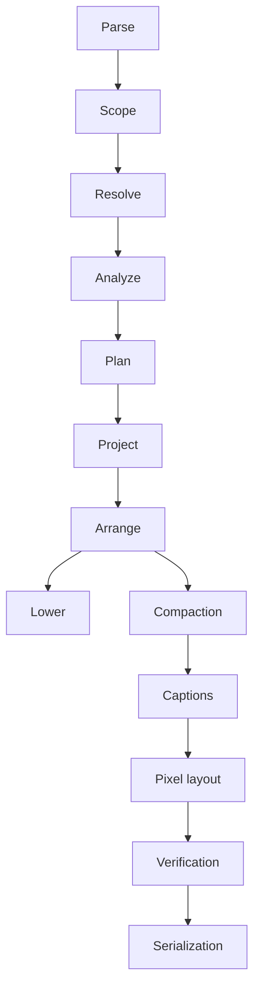

# Compiler and SVG Pipeline

The language and algorithm contracts live in [the RFCs](rfcs/).

## Crate boundaries

| Crate                                                         | Responsibility                                                                                                                                                                                                                                                                                                                                                                 |
| ------------------------------------------------------------- | ------------------------------------------------------------------------------------------------------------------------------------------------------------------------------------------------------------------------------------------------------------------------------------------------------------------------------------------------------------------------------ |
| [`kaalang`](../crates/kaalang/src/lib.rs)                     | Re-export the public macro; own executable examples, compile-fail tests, and generated fixture diagrams.                                                                                                                                                                                                                                                                       |
| [`kaalang-macros`](../crates/kaalang-macros/src/lib.rs)       | Validate attribute arguments, parse the item, and delegate expanding a flow or a datatype to the compiler.                                                                                                                                                                                                                                                                     |
| [`kaalang-compiler`](../crates/kaalang-compiler/src/lib.rs)   | Analyze flows, verify execution plans, project topology, decide and check arrangements, and lower plans to Rust. Parse type declarations and expand datatypes. Behind the `source` feature, read flows and types from the text of a file for the renderers, say what each drawn element of a flow or a type stands for there, and find the flow or type declared at an offset. |
| [`kaalang-render`](../crates/kaalang-render/src/lib.rs)       | Compact verified arrangements using shared compiler checks and additional cycle-boundary checks.                                                                                                                                                                                                                                                                               |
| [`kaalang-svg`](../crates/kaalang-svg/src/lib.rs)             | Derive captions, measure and verify pixel geometry, compose stages, list each diagram's hotspots, lay out type diagrams, and serialize standalone SVG.                                                                                                                                                                                                                         |
| [`kaalang-cli`](../crates/kaalang-cli/src/main.rs)            | Read Cargo metadata for one compilation target, read each target's module tree and resolve Rust paths across them through `kaalang-workspace`, select the flow or type through the compiler, order its incoming cards, render the SVG, and write it to the selected destination.                                                                                               |
| [`kaalang-testing`](../crates/kaalang-testing/src/lib.rs)     | Share the executable fixture corpus, generated probes, cycle shapes, and performance harness with tests; unpublished.                                                                                                                                                                                                                                                          |
| [`kaalang-workspace`](../crates/kaalang-workspace/src/lib.rs) | Order Cargo targets as their cards stand, find the files module declarations load, read each target's module tree, and resolve Rust paths across those trees. The compiler knows no workspace.                                                                                                                                                                                 |
| [`kaalang-js`](../crates/kaalang-js/src/lib.rs)               | Expose diagram rendering, declaration ranges, and module lookup to JavaScript through WebAssembly. Translate byte positions to UTF-16 offsets; unpublished.                                                                                                                                                                                                                    |

## Compiler steps

| Step    | Implementation                                                                                                                                   | Algorithm                                                                                                                                                                                                    | Artifact                                                                                         |
| ------- | ------------------------------------------------------------------------------------------------------------------------------------------------ | ------------------------------------------------------------------------------------------------------------------------------------------------------------------------------------------------------------ | ------------------------------------------------------------------------------------------------ |
| Parse   | [`parse/`](../crates/kaalang-compiler/src/parse/mod.rs)                                                                                          | Validate each statement locally, flatten cycle bodies in source order, append the implicit end block.                                                                                                        | Parsed `Flow`.                                                                                   |
| Scope   | [`scope.rs`](../crates/kaalang-compiler/src/scope.rs)                                                                                            | Give cycle-local wires unique internal keys while retaining authored spellings; record the outer wires each cycle body captures.                                                                             | Scoped `Flow`.                                                                                   |
| Resolve | [`resolve.rs`](../crates/kaalang-compiler/src/resolve.rs)                                                                                        | Check that every capture names an earlier producer and that declarations and mutability agree.                                                                                                               | Wire-validated `Flow`.                                                                           |
| Analyze | [`analyze/`](../crates/kaalang-compiler/src/analyze/mod.rs), [`symbolic/validate.rs`](../crates/kaalang-compiler/src/symbolic/validate.rs)       | Validate reachability, captures, branch participation, placement, merges, and convergence over enumerated histories or exact execution conditions.                                                           | `Executions`, `Vec<WireMerge>`, and `Vec<ConvergenceGroup>`.                                     |
| Plan    | [`plan/`](../crates/kaalang-compiler/src/plan/mod.rs), [`symbolic/plan/`](../crates/kaalang-compiler/src/symbolic/plan/mod.rs)                   | Build a nested branch/join plan; independently replay it over the complete execution domain using the selected representation.                                                                               | `ExecutionPlan`, packaged with preceding artifacts as `Analysis`.                                |
| Project | [`topology/`](../crates/kaalang-compiler/src/topology/mod.rs), [`symbolic/projection.rs`](../crates/kaalang-compiler/src/symbolic/projection.rs) | Build nodes, exits, junctions, cycle boundaries, for-entry and for-end nodes, connections, back edges, and placement-only order. Preserve per-history transitive reduction when taking the connection union. | `Topology`.                                                                                      |
| Arrange | [`construct/`](../crates/kaalang-compiler/src/construct/mod.rs)                                                                                  | Find abstract ranks, columns, corridors, lanes, and cycle contours; independently verify the witness.                                                                                                        | Verified `Arrangement`; `build` packages it with `Analysis` and `Topology` as a `SemanticModel`. |
| Lower   | [`codegen/`](../crates/kaalang-compiler/src/codegen/mod.rs)                                                                                      | Emit hygienic Rust from the verified execution plan.                                                                                                                                                         | Lowered `ItemFn`.                                                                                |

[`analyze`](../crates/kaalang-compiler/src/lib.rs) returns an `Analysis` with a
verified plan without checking diagram realizability. `expand` checks the
expanded diagram before emitting Rust, then discards its arrangement; macro
expansion runs no compaction or SVG layout.

When a function or datatype has conditional parameters, the attribute lets rustc
evaluate their predicates before the compiler reads the signature.

For each local flow, `build_with_options` constructs the expanded projection
first, and a requested collapsed one only after it succeeds.

## Execution representation

[`analyze_local`](../crates/kaalang-compiler/src/lib.rs) selects one of two
exact representations. Local flows with at most `ENUMERATED_HISTORY_LIMIT`
finite histories use the ordinary execution list. When the product of declared
alternatives exceeds that threshold,
[`symbolic/walk/`](../crates/kaalang-compiler/src/symbolic/walk/mod.rs) first
builds conditions and counts the actual domain with a capped query. A small
actual domain still uses the ordinary path.

Larger domains retain an ordered, reduced decision graph in
[`symbolic/condition.rs`](../crates/kaalang-compiler/src/symbolic/condition.rs).
It shares decision suffixes and records conditions for block participation,
producer occurrences, capture dependencies, and final outcomes. Cycles,
preparation, and stage transitions use this same representation without
unfolding iterations or visits. Validation, plan verification, and connection
reduction query the whole domain; concrete witnesses supply only union facts.
[RFC 0007 §5.1](rfcs/0007-language-refinements.md#51-finite-cycle-analysis)
specifies the algorithm.

[`Executions`](../crates/kaalang-compiler/src/executions.rs) hides the storage
choice. `len()` counts without materializing summaries; its `Vec` interface
enumerates and caches the complete list, which can still be exponential. The
ordinary implementation is the reference for
[`symbolic/tests.rs`](../crates/kaalang-compiler/src/symbolic/tests.rs).

## Staged flows

A flow that declares stages uses separate local analyses and diagrams for
preparation and each stage. `Analysis::stages` and `SemanticModel::stages`
retain declaration order; reachability and Rust constructor ordering use the
shared transition graph.

Preparation is analyzed twice. The preliminary pass skips producer-usage checks
to find outer-plan bindings available on every completing route. Stage analyses
then determine which common wires they use; those dependencies are added to
preparation's transitions before the final pass checks usage.

| Step    | Implementation                                                                                                                                     | Algorithm                                                                                                                                                                                                                                                                                           |
| ------- | -------------------------------------------------------------------------------------------------------------------------------------------------- | --------------------------------------------------------------------------------------------------------------------------------------------------------------------------------------------------------------------------------------------------------------------------------------------------- |
| Split   | [`parse/stage.rs`](../crates/kaalang-compiler/src/parse/stage.rs)                                                                                  | Split preparation from the stage declarations, resolve every entry and declared output, and append one transition block per possible signal.                                                                                                                                                        |
| Analyze | [`stage.rs`](../crates/kaalang-compiler/src/stage.rs)                                                                                              | Derive common outer data, analyze the local parts with their boundary dependencies, and reject stages unreachable in the transition graph.                                                                                                                                                          |
| Arrange | [`topology/stage.rs`](../crates/kaalang-compiler/src/topology/stage.rs), [`construct/stage.rs`](../crates/kaalang-compiler/src/construct/stage.rs) | Order every other local sink before each transition, place a part's transitions on one final rank, and verify their row and distinct columns.                                                                                                                                                       |
| Lower   | [`codegen/stage.rs`](../crates/kaalang-compiler/src/codegen/stage.rs)                                                                              | Keep preparation's outer scope around a labeled dispatcher loop whose state is a balanced `Result` sum of the stage entries; each arm runs one stage's local plan, in visit order.                                                                                                                  |
| Compose | [`flow/layout/staged.rs`](../crates/kaalang-svg/src/flow/layout/staged.rs)                                                                         | Measure each compacted part with the common entry and transition height, align transitions on one row, and place preparation left of stages in declaration order. Empty preparation contributes only the function header. Verify the composed rails and return contour against every part's bounds. |

## Arrangement algorithms

| Order      | Algorithm                               | What it does                                                                                                                                                                                                                         |
| ---------- | --------------------------------------- | ------------------------------------------------------------------------------------------------------------------------------------------------------------------------------------------------------------------------------------ |
| Primary    | Preferred, conflict-guided search       | Starts with earliest ranks, unsunk cycle tails, preferred contour sides, and direct corridors. A reported conflict widens the responsible route (`direct` → `deferred` → `aside`), flips the responsible contour, or sinks its tail. |
| Fallback 1 | Deciding sweep with straight back edges | Enumerates legal vertex/case-row events, frontier orders and shared-rail exchanges while solving persistent column inequalities. Completed witnesses are reconstructed and independently checked.                                    |
| Fallback 2 | Deciding sweep with flexible back edges | Repeats the complete sweep with variable, possibly bent back-edge corridors. Exhaustion rules out the remaining legal arrangements.                                                                                                  |

Static constraint contradictions can reject a topology before the sweep;
otherwise rejection requires exhaustion with flexible back edges. The production
searches have no timeout, retry, coordinate, or bend limit that can reject a
topology. The separate exhaustive procedure under
[`construct/tests/reference.rs`](../crates/kaalang-compiler/src/construct/tests/reference.rs)
is a test oracle, not a runtime fallback. It uses separate event enumeration, a
sparse difference constraint graph with strongly connected components and
longest paths, and a separate strip router. It retains fresh coordinates for
every live path on each row instead of production's interval projection and
transitive-closure key. Positive-only preliminary attempts speed up witness
discovery; their exhaustion always falls through to the full enumeration. A
bound on the states it visits panics rather than count as a negative answer. It
shares topology facts and the independent verifier with production, not
transitions, pruning, column solver or reconstruction.

Exhaustive comparisons cover distributor bodies and ordered-question bodies and
count drawn, refused, and earlier-rejected outcomes separately. Neither domain
holds a refusal: validation rejects an exit enclosed between repeating routes
before construction. A separate test compares the production search with
memoization and separator refusal disabled. Mutated arrangements break
corridors, contours, lanes, and branch order, and the verifier must reject each.
Agreement supplements the coverage and soundness arguments of
[RFC 0003 §2.1](rfcs/0003-svg-renderer.md#21-the-decision-procedure); it does
not replace them.

The memo cache stops growing at `MEMO_CACHE_BYTES`. That limits a performance
optimization, not the search: a state it does not hold is explored again.

## Rendering steps and fallbacks

`kaalang-svg` keeps each diagram's steps in its own module, `flow/` and
`datatype/`, over the text measurement in `text.rs` and the SVG markup in
`markup.rs` that both share.

`kaalang-render`'s
[`ArrangementVerifier`](../crates/kaalang-render/src/verify/mod.rs) checks each
compaction candidate with the compiler's shared arrangement checks and the
cycle-boundary checks. `kaalang-svg` assigns dimensions and spacing to the
compacted arrangement; its rows, columns, and corridors stay fixed.

| Step                                                                                                             | Primary path                                                                                                                                                                                         | Artifact                           | Fallback                                                                                                                                                                            |
| ---------------------------------------------------------------------------------------------------------------- | ---------------------------------------------------------------------------------------------------------------------------------------------------------------------------------------------------- | ---------------------------------- | ----------------------------------------------------------------------------------------------------------------------------------------------------------------------------------- |
| [Compaction](../crates/kaalang-render/src/compact.rs)                                                            | Iterate verified local simplifications: pull contours inward, shorten routes, straighten branch departures, merge lanes and columns, lift vertices, fold rows.                                       | Compacted `Arrangement`.           | Keep the previous verified arrangement whenever a candidate fails. The process finds a deterministic local fixed point, not a global minimum.                                       |
| [Labels and captions](../crates/kaalang-svg/src/flow/captions/mod.rs), [text](../crates/kaalang-svg/src/text.rs) | Validate raw and interpreted label characters for XML; derive semantic labels and take the quoted source text as read; interpret restricted Markdown and measure formulas once per caption.          | `Captions`.                        | A formula that cannot be laid out or exceeds the height limit stays literal; one wider than its label is clipped with an ellipsis.                                                  |
| [Pixel layout](../crates/kaalang-svg/src/flow/layout/mod.rs)                                                     | Wrap measured text, realize the arrangement with narrow gaps for routing-only columns, and increase bounded slack when labels and back edges share a gap.                                            | `Scene`.                           | Retry the same arrangement with standard column spacing, including the same bounded slack loop. A visible cycle caption may shorten or disappear; its full text remains accessible. |
| [Verification](../crates/kaalang-svg/src/flow/layout/mod.rs)                                                     | Check route geometry and arrangement correspondence, then labels, cycle boundaries, canvas bounds, and correspondence again after final translation. Verify staged composition before serialization. | Verified `Scene` or `StagedScene`. | None: an unverified scene is never serialized.                                                                                                                                      |
| [Serialization](../crates/kaalang-svg/src/flow/svg/mod.rs), [markup](../crates/kaalang-svg/src/markup.rs)        | Write escaped Unicode, embedded CSS, accessible text, nodes, boundaries, and paths to one standalone SVG string.                                                                                     | Standalone SVG `String`.           | None.                                                                                                                                                                               |

Before these steps, the compiler's
[`SourceFile`](../crates/kaalang-compiler/src/source/mod.rs) parses the Rust
file, removes what the compilation target does not compile, takes the flow at
the position the caller selected, builds its model, and cuts the text the
diagram quotes from its signature. The entry point
[`render_flow`](../crates/kaalang-svg/src/lib.rs) takes that flow. `kaalang-svg`
reads no source text; it reports a label's position from the span it received,
with the compiler's `line_and_column`. Positions need the compiler's `source`
feature, which the macro leaves off, since rustc gives it tokens.

Between verification and serialization `kaalang-svg` reads the hotspots it
returns beside the SVG from the verified scene in
[`flow/navigation.rs`](../crates/kaalang-svg/src/flow/navigation.rs): a
rectangle for every node, drawn cycle boundary, and wire name, with the source
it stands for, and for every segment of a connection and every merge, with its
ribbon. What a node draws, where a producer binds its wire, and what a `return`
hands to end are the compiler's facts, in
[`source/spans.rs`](../crates/kaalang-compiler/src/source/spans.rs), and so is
the ribbon of each connection and merge, in
[`source/ribbons.rs`](../crates/kaalang-compiler/src/source/ribbons.rs). Neither
crate decides what a click does: that is the reader's. `Captions` keeps, with
every list of wire names a label draws, where each producer binds its wire; a
wire label records which list it draws, and the label module finds each name's
rectangle on its lines. `SourceFile::range` turns a hotspot's span into bytes of
the text as given.

## Type diagrams

A type diagram has no arrangement to decide or compact. The entry point
[`render_type`](../crates/kaalang-svg/src/lib.rs) takes the focus card and the
incoming cards from its caller, which reads each card's type through the
compiler's `SourceFile` for its compilation target and decides the relationships
each card draws into the focus. For the CLI and the bindings alike, the
`CargoTarget` of `kaalang-workspace` orders the cards' targets and starts their
row groups, and `card_headers` shortens their paths by RFC 0010. A rendering
error names its card, so the CLI can name its file and the editor can leave an
invalid incoming card out. Beside the SVG the renderer returns the hotspots of
[`datatype/navigation.rs`](../crates/kaalang-svg/src/datatype/navigation.rs):
every path a tile's type names, every relationship's target, and every incoming
card's header, each with its card. Where each path stands in a field's type,
where each relationship names its target, and which relationships an editor's
source offsets identify are the compiler's facts, in
[`source/cards.rs`](../crates/kaalang-compiler/src/source/cards.rs).

| Step                                                                                                      | Work                                                                                                                                                                                                                                                                                                                                                                                                                                                                                                             |
| --------------------------------------------------------------------------------------------------------- | ---------------------------------------------------------------------------------------------------------------------------------------------------------------------------------------------------------------------------------------------------------------------------------------------------------------------------------------------------------------------------------------------------------------------------------------------------------------------------------------------------------------- |
| [Reading](../crates/kaalang-svg/src/datatype/mod.rs)                                                      | Read each card's form, representation, and tiles from its type as the compiler read it, with the text it quotes from the declaration, and validate every label for XML.                                                                                                                                                                                                                                                                                                                                          |
| [Card layout](../crates/kaalang-svg/src/datatype/layout.rs)                                               | Wrap and measure each card, place the incoming cards in rows above the focus, each target group from a new row and each row as wide as a screen or the focus, and route each drawn relationship without crossings: an incoming card lists its tiles, whose lines start on its right side and join its column's trunk down into the focus; the focus's own lines leave a struct's row below it, a union field from its side, and a variant through its groove and port, and join its trunk, which climbs over it. |
| [Serialization](../crates/kaalang-svg/src/datatype/svg.rs), [markup](../crates/kaalang-svg/src/markup.rs) | Write the cards, their rules and text, and the routes to one standalone SVG string.                                                                                                                                                                                                                                                                                                                                                                                                                              |

## IDEs

kaalang supports VS Code. Every supported IDE shows
[`ide/page/`](../ide/page/page.js), a page in plain JavaScript. It runs
`kaalang-js` in a worker, draws the flow or the type at the editor's cursor,
lists the ribbon of a clicked connection or merge, and asks its host to reveal a
range, to run the editor's own go-to action at a position, for the types of
values, and for the files that refer to a type, each with its references and its
place in the module tree; a host gives the text, the cursor, the target's cfg
set, and what the editor knows.

In VS Code, [`ide/vscode/`](../ide/vscode/src/target.ts) takes that set from
rust-analyzer, whose status report gives the set of each crate a file belongs
to, with its settings, the package's features, and build-script cfgs applied, so
that the diagram counts the code the editor shows as active. It asks again
whenever changes pause, since rust-analyzer changes the set as it loads the
workspace and reruns build scripts; until it answers, the diagram goes without
one. Cargo only lists the workspace's targets, without dependencies, so it
neither reads nor writes the lockfile; a target whose required features are off
is read too, as rust-analyzer reads it.

A type diagram's incoming cards come from rust-analyzer's references to the
focus; kaalang resolves no Rust path for the editor. A reference search stops at
a `use` that renames the type, so where one does, the host checks through
rust-analyzer's definition every relationship target in the module files the
compiler finds as the CLI does. rust-analyzer reads a file that several targets
include in one crate, the first its status report lists, so the host sends each
file once, with that crate's set and place in the module tree: code that crate
leaves inactive, as the editor shows it, draws no card, and neither do the other
copies, which the CLI draws. The panel follows Rust editors in the workspace
folders and the sources their Cargo targets include elsewhere. It opens what a
click finds as the editor's own go-to does, from where the cursor stands, so
that the diagram follows only the target and going back returns. In Restricted
Mode it runs no cargo, whose binary the workspace's configuration may name, and
rust-analyzer does not run: what rust-analyzer gives, the set, the types,
incoming cards, module paths, and go-to actions, waits for trust.
